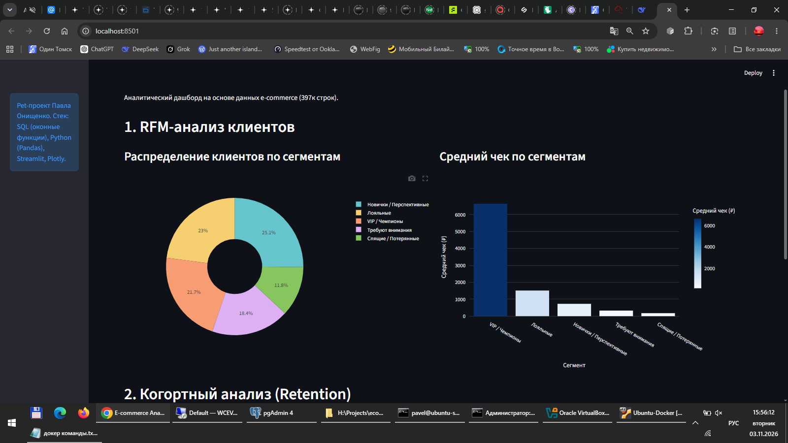
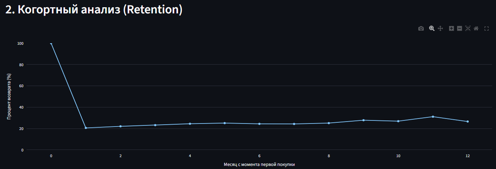
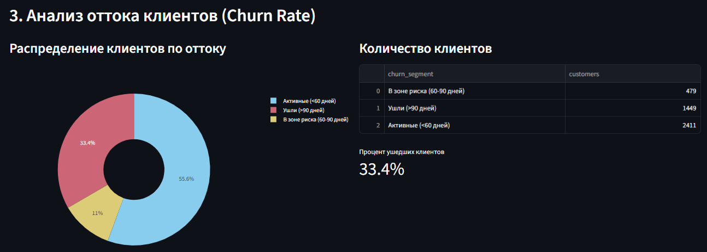
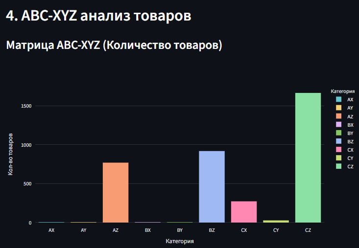
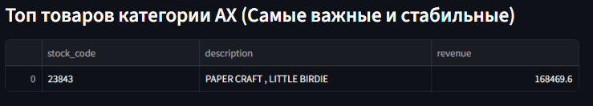
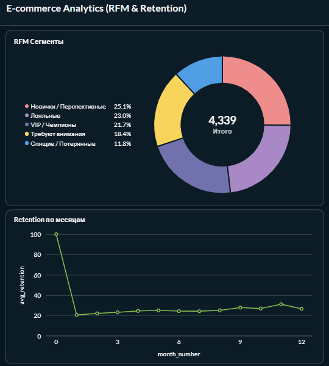
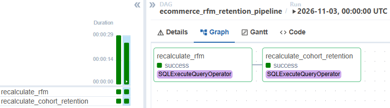

# E-commerce Analytics: RFM & Retention

Аналитический pet-проект на реальном датасете (397 924 строки транзакций). 
Демонстрирует полный цикл работы с данными: от загрузки и очистки до продвинутой аналитики и визуализации.

## 🎯 Бизнес-задачи, которые решает проект:
1. **RFM-анализ:** Сегментация клиентов по давности, частоте и сумме покупок для выявления VIP-клиентов и "спящих" пользователей.
2. **Когортный анализ (Retention):** Оценка удержания клиентов по месяцам (какой процент возвращается после первой покупки).
3. **Визуализация:** Построение интерактивных дашбордов для бизнеса.

## 🛠 Стек технологий:
- **Python (Pandas, SQLAlchemy):** Загрузка и первичная очистка данных.
- **SQL (PostgreSQL):** Расчет RFM-метрик (оконные функции `NTILE`, `CASE`) и когортного анализа.
- **Streamlit + Plotly:** Интерактивный веб-дашборд.
- **Metabase:** BI-дашборд для руководителей.

## 🚀 Как запустить:
1. Установите зависимости: `pip install -r requirements.txt`
2. Загрузите данные: `python load_data.py`
3. Запустите расчеты: `python run_rfm.py` и `python run_cohort.py`
4. Запустите дашборд: `streamlit run app.py`

## 📊 Результаты и визуализация:

### 1. Streamlit Dashboard (Python + Plotly)
Интерактивный дашборд, написанный на Python. Показывает полный цикл аналитики e-commerce:
- **RFM-сегментация:** Кто наши клиенты и сколько они тратят.
- **Retention (Когорты):** Как долго клиенты остаются с нами.
- **Churn Rate (Отток):** Кто перестал покупать.
- **ABC-XYZ анализ:** Какие товары приносят деньги и насколько стабильны их продажи.

### 2. Metabase Dashboard (BI-инструмент)
Классический BI-дашборд для руководителей, настроенный в Metabase (круговая диаграмма RFM + линейный график Retention).

### 💡 Выводы (Insights):
1. **RFM:** Сегмент "VIP / Чемпионы" составляет ~22% клиентов, но приносит основную долю выручки (средний чек 6634 руб.).
2. **Retention:** После первой покупки возвращается около 20% клиентов, но те, кто вернулся во второй месяц, остаются с вероятностью ~25% на долгие месяцы (эффект "плато").
3. **Churn:** 33.4% клиентов ушли (не покупали более 90 дней). Еще 11% в зоне риска. Требуется программа возврата (win-back).
4. **ABC-XYZ:** Товар "PAPER CRAFT, LITTLE BIRDIE" — абсолютный лидер (выручка 168 469). Однако огромное количество товаров в категории **CZ** (хаотичный спрос, низкая выручка) — это сигнал для оптимизации складских запасов.

### ⚙️ Оркестрация (Apache Airflow)

Для автоматического пересчета витрин по расписанию (ежедневно) настроен DAG в Apache Airflow.
Пайплайн выполняет SQL-скрипты последовательно: сначала пересчитывает RFM-сегменты, затем когорты Retention.

